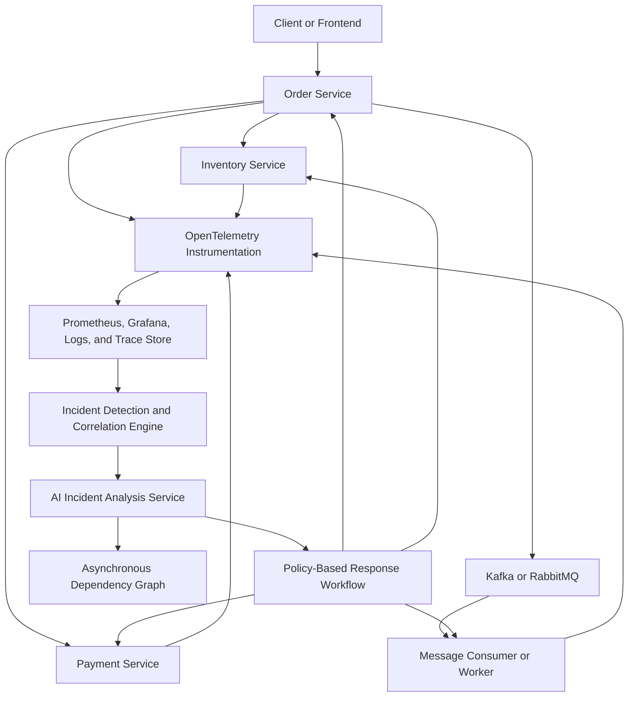

# AgentMesh: Distributed AI Incident Detection and Response Platform

## Development status

Order and Analysis currently provide service skeletons and health endpoints only.
See [development instructions](docs/development.md), [shared contract decisions](docs/decisions.md)
and [contract semantics](docs/contract-protocol.md). The architecture and demo below
remain project goals; business processing, AI and recovery are not implemented.

## Abstract

AgentMesh is a distributed AI-assisted incident detection and response platform for microservice-based applications. The system monitors independent services such as Order, Inventory, and Payment Services, detects failures, collects logs, metrics, and distributed traces, and uses an AI analysis service to identify probable root causes.

The platform supports both synchronous REST communication and asynchronous communication through a message broker. A central project challenge is maintaining causal trace information across asynchronous message boundaries. AgentMesh will inject and extract W3C Trace Context information, including `traceparent` and `tracestate`, within messages sent through Kafka or RabbitMQ. This enables the AI agent to reconstruct producer-consumer dependency graphs and analyze the complete causal path of an incident instead of relying on isolated service logs.

When an incident is detected, AgentMesh generates an evidence-based explanation and recommends a controlled recovery action, such as retrying a request, activating a circuit breaker, restarting a service, reprocessing a message, or rolling back a faulty deployment. Predefined policies will control automated actions, while high-risk actions will require human approval.

## Business Value

Failures in distributed systems can affect multiple services, and the root cause may occur in a different service or through an asynchronous message flow. Engineers often need to manually inspect logs, metrics, traces, and message queues, increasing recovery time and operational cost.

AgentMesh provides the following business value:

- Reduces the time required to detect and diagnose distributed-system incidents.
- Reconstructs the causal path of failures across REST calls and message brokers.
- Helps engineers distinguish root causes from secondary failures.
- Provides human-readable explanations instead of requiring manual log analysis.
- Recommends safe and repeatable recovery actions.
- Supports fault tolerance through retries, timeouts, circuit breakers, message reprocessing, and dead-letter queues.
- Improves observability by preserving trace context across asynchronous producer-consumer workflows.
- Reduces the risk of unsafe automated recovery through policy-based controls and human approval.
- Provides a foundation for reliable AI-assisted operations in distributed applications.

## Proposed Architecture



For synchronous REST requests, OpenTelemetry propagates W3C Trace Context through HTTP headers. For asynchronous communication, the producer will inject the trace context into the message payload or message headers before publishing it to the broker. The consumer will extract this context when processing the message and continue the same trace.

This allows AgentMesh to connect the following sequence:

```text
Client request
    → Order Service
    → Broker message
    → Message Consumer
    → Inventory or Payment Service
    → Database operation
    → Error or timeout
```

The AI analysis service will use the correlated trace, logs, metrics, service dependencies, and message-processing history to identify the most probable cause of an incident.

## Proposed Technology Used

- **Service development:** Java and Spring Boot
- **AI analysis service:** Python
- **Service communication:** REST APIs
- **Asynchronous messaging:** Apache Kafka or RabbitMQ
- **Databases:** PostgreSQL
- **Caching and temporary state:** Redis
- **Containerization:** Docker and Docker Compose
- **Observability:** OpenTelemetry, Prometheus, Grafana, and a trace backend
- **Distributed tracing:** W3C Trace Context using `traceparent` and `tracestate`
- **AI and incident analysis:** Large language model with structured incident data
- **Knowledge retrieval:** Vector database for comparison with previous incidents
- **Response orchestration:** Policy-based workflow engine
- **Recovery mechanisms:** Health checks, retries, timeouts, circuit breakers, message reprocessing, dead-letter queues, and controlled rollback

## Project Challenge: Causal Trace Propagation Across Message Brokers

Standard OpenTelemetry propagation works well for synchronous REST communication, but trace context can be lost when a request is converted into an asynchronous Kafka or RabbitMQ message. Without this context, the system may show separate logs for the producer and consumer without proving that they belong to the same transaction.

AgentMesh will address this challenge by:

1. Injecting W3C trace context into every relevant outgoing message.
2. Extracting the trace context when a consumer receives the message.
3. Continuing the trace across the producer, broker, consumer, and downstream services.
4. Recording message identifiers, parent-child relationships, timestamps, and processing status.
5. Building an asynchronous producer-consumer dependency graph.
6. Providing the correlated graph to the AI analysis service.
7. Using the complete causal chain to identify probable root causes and recommend recovery actions.

This ensures that AgentMesh analyzes distributed incidents using connected evidence across the entire system rather than analyzing each service log independently.

## Expected Demonstration

The demonstration will show a normal request passing through the Order, Inventory, and Payment Services. The team will then introduce a controlled failure, such as stopping a service, adding artificial latency, or preventing a message consumer from processing events.

AgentMesh will detect the failure, preserve and reconstruct the trace across the message broker, collect the relevant system information, generate an AI explanation of the probable cause, recommend a recovery action, and verify whether the system has returned to a healthy state.

## Project Goal

The goal of AgentMesh is to demonstrate how AI can assist with monitoring and incident response in distributed systems while maintaining reliability and safety through workflow-based control. The project combines microservices, event-driven architecture, causal distributed tracing, observability, fault tolerance, and AI-assisted root-cause analysis in a practical application.
